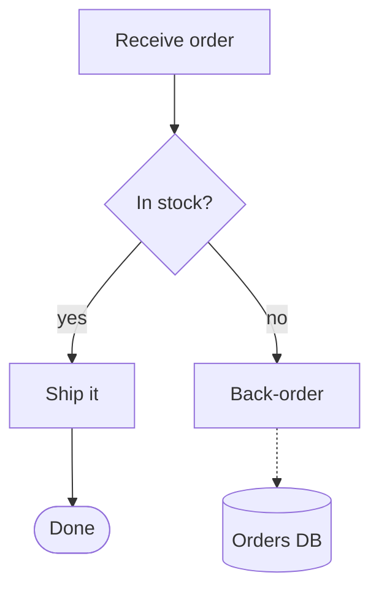
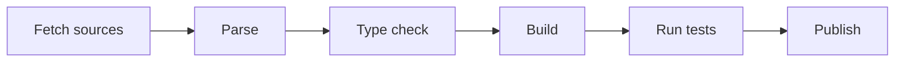
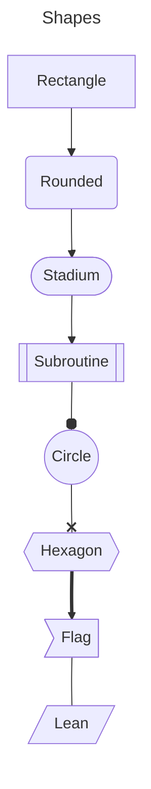
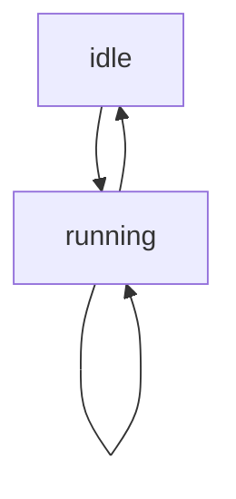
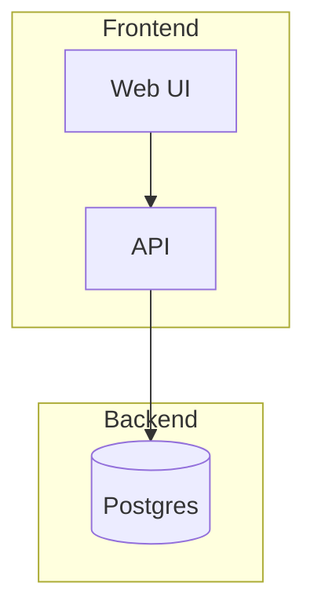
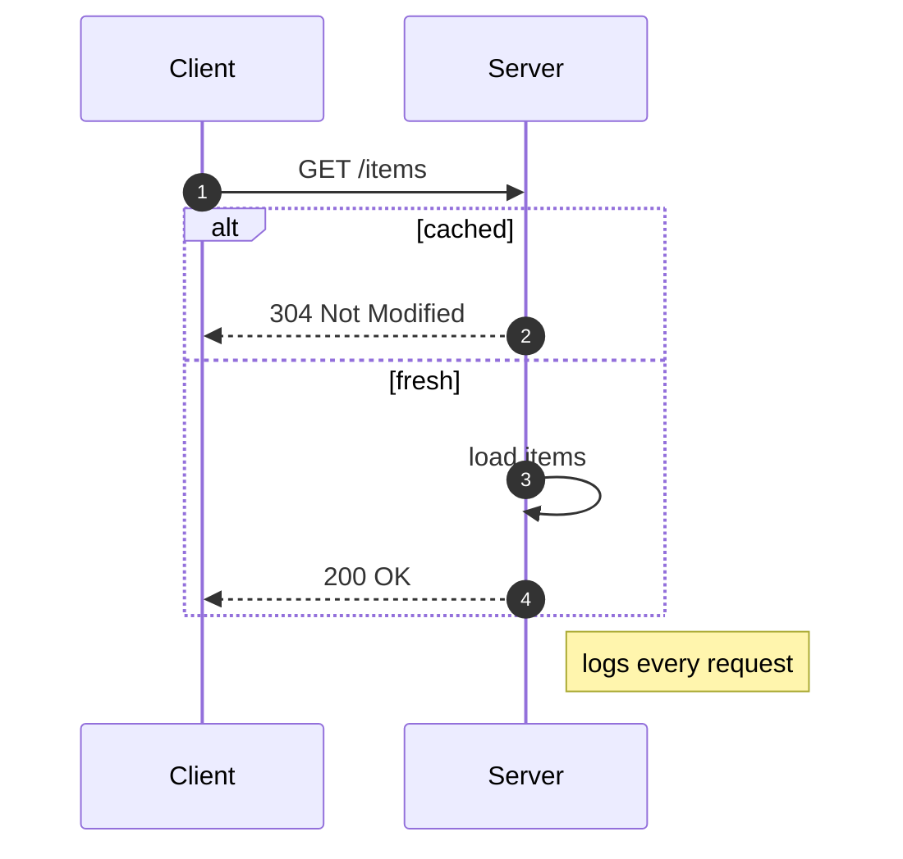
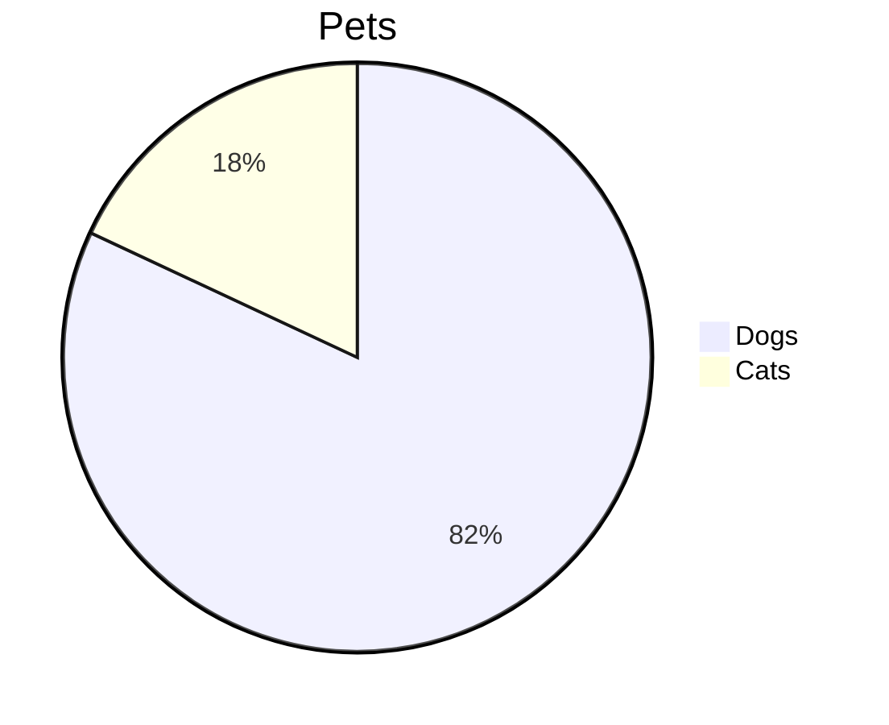

# Diagrams

A top-down flowchart with a decision:



A left-to-right pipeline that may need to turn on narrow screens:



Shapes, heads and a title:



A cycle and a self-loop:



Labels in other scripts:

```{mermaid}
:caption: MyST options are ignored
flowchart LR
    u[ユーザー] -->|リクエスト| s[認証サービス]
    s --> d[(데이터베이스)]
```

Subgraphs are listed as an outline for now:



A sequence diagram:



Types folio does not draw, and mistakes, show their source:



```mermaid
flowchart TD
    A --> B -|oops
```

```mermaid
```
